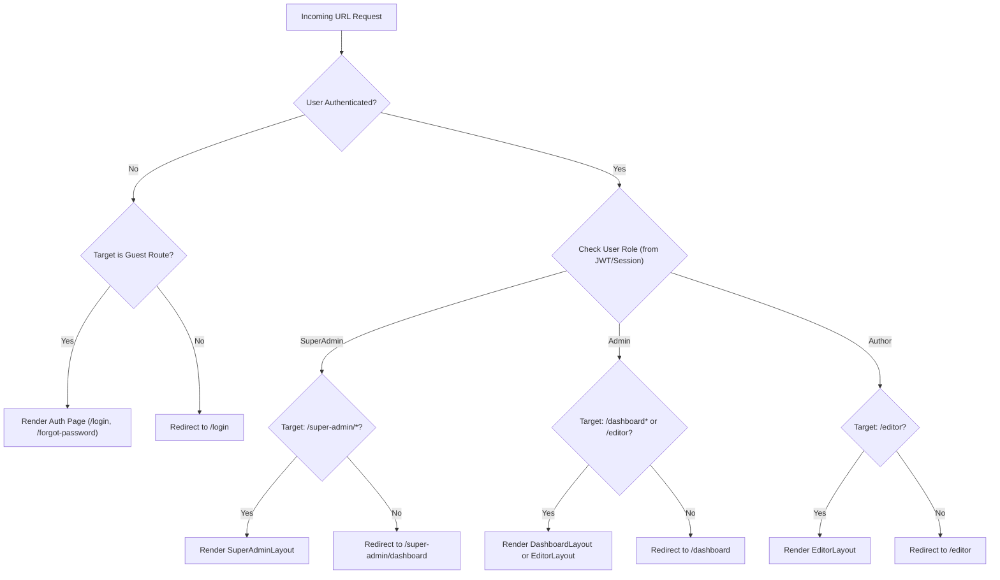

# 01. PROJECT OVERVIEW & ROUTE DOCUMENTATION
## CoEdit.ai (DocuPilot / Smart Authoring Suite)

---

## 1. PROJECT OVERVIEW

### 1.1 Executive Summary
**CoEdit.ai** (internally designated as *DocuPilot* / *Smart Authoring Suite*) is a high-performance web-based document authoring, regulatory compliance, and workspace administration single-page application (SPA). Designed primarily for structured clinical, regulatory, and technical documentation workflows, CoEdit.ai integrates Microsoft Word–grade document authoring capabilities directly into the browser alongside administrative governance, role-based security, and AI-assisted drafting.

The application is structured into two primary functional divisions:
1. **System Administration Portal (Admin Module):** Provides administrators with system-level visibility, dynamic user statistics, role distribution metrics, full user lifecycle administration (Author vs. Admin roles), security credential resets, Excel report generation, and administrative account security management.
2. **Document Authoring Environment (Editor Module):** Delivers a rich-text editing experience featuring dynamic multi-page virtualized canvas pagination, an Office-style Ribbon toolbar (Home, Insert, Layout, Review, and contextual Header & Footer tabs), an expandable tool rail with 10+ modular side panels, interactive Find & Replace with in-DOM highlight traversal, and multi-format document import/export.

---

## 2. FRONTEND TECHNOLOGY STACK

The frontend application stack has been verified directly from the root `editor/package.json` and production configuration files:

| Technology / Library | Version | Category | Architectural Purpose in CoEdit.ai |
|---|---|---|---|
| **React** | `^19.2.6` | UI Core Framework | Component architecture, state hooks, and virtual DOM rendering |
| **React DOM** | `^19.2.6` | Rendering Engine | Mounting and browser DOM tree reconciliation |
| **TypeScript** | `~6.0.0` | Programming Language | Strict static type safety, interfaces, data models, and compile-time verification |
| **Vite** | `^8.1.5` | Build Tool & Bundler | Hot Module Replacement (HMR) dev environment and optimized production bundling |
| **Tailwind CSS** | `^4.0.0` | Styling Engine | Utility-first styling via `@tailwindcss/vite` |
| **React Router DOM** | `^7.18.1` | Client-Side Routing | Declarative routing, nested layout trees, client navigation, and route guards |
| **Zustand** | `^5.0.14` | Global State Store | High-performance, un-opinionated reactive global stores (`useUsersStore`, `navigationStore`) |
| **TanStack React Query** | `^5.101.4` | Server State Management | Asynchronous caching, optimistic updates, and background data synchronization |
| **React Hook Form** | `^7.82.0` | Form Management | Controlled and uncontrolled form state tracking with minimal re-renders |
| **Zod** | `^4.4.3` | Validation Schema | Runtime type validation, boundary verification, and schema declarations |
| **@hookform/resolvers** | `^5.4.0` | Form-Schema Bridge | Integration layer connecting Zod validation schemas with React Hook Form |
| **Lucide React** | `^1.28.0` | Iconography | Standardized, accessible SVG icon components |
| **Radix UI / Shadcn / Base UI**| Multiple | Headless UI Primitives | Accessible modal dialogs, popovers, dropdown menus, selects, and tooltips |
| **SheetJS (xlsx)** | `^0.18.5` | Spreadsheet Engine | Client-side Excel workbook generation and export (`.xlsx`) |
| **Recharts** | `^3.8.0` | Data Visualization | SVG-based charting engine for document figures and data analytics |
| **pdfjs-dist** | `^6.4.299` | PDF Engine | Client-side PDF document parsing, page geometry, and rendering |
| **JSZip** | `^3.10.2` | Archive Packaging | Client-side compression and package unpacking for document archives |

---

## 3. PROJECT ARCHITECTURE & DIRECTORY STRUCTURE

The application codebase is contained within the `editor/` root folder, following a modular domain-driven architecture:

```text
editor/
├── public/                         # Public static assets, favicon, web manifests
├── src/
│   ├── app/                        # Application core bootstrap and configuration
│   │   ├── config/                 # Navigation items, roles, permissions, constants
│   │   │   ├── constants.ts        # App-wide constant strings and limits
│   │   │   ├── env.ts              # Verified environment variable bindings
│   │   │   ├── navigation.ts       # Central navigation links and role mappings
│   │   │   ├── permissions.ts      # Permission tokens and access control definitions
│   │   │   └── roles.ts            # Role enum (Admin, Author, SuperAdmin) and normalizers
│   │   ├── guards/                 # Client route protection wrappers
│   │   │   ├── AuthGuard.tsx       # Ensures user is authenticated; redirects to /login
│   │   │   ├── GuestGuard.tsx      # Restricts authenticated users from visiting /login
│   │   │   ├── PermissionGuard.tsx # Fine-grained permission checks
│   │   │   └── RoleGuard.tsx       # Enforces allowed user roles per route
│   │   ├── layouts/                # Structural layout wrappers
│   │   │   ├── AuthLayout.tsx      # Centered card layout for guest auth pages
│   │   │   ├── DashboardLayout.tsx # Admin portal layout (Sidebar, Header, Main Outlet)
│   │   │   ├── EditorLayout.tsx    # Full-screen authoring layout (Ribbon, Sidebar, Canvas)
│   │   │   ├── RootLayout.tsx      # Root outlet with top-level providers and toasts
│   │   │   └── SuperAdminLayout.tsx# Multi-tenant management shell
│   │   ├── providers/              # React context providers
│   │   │   ├── AppProvider.tsx     # Aggregated top-level providers
│   │   │   ├── QueryProvider.tsx   # TanStack Query client configuration
│   │   │   └── theme-provider.tsx  # Dark / Light mode provider and DOM class controller
│   │   ├── router/                 # React Router definitions
│   │   │   ├── index.tsx           # Router instance instantiation
│   │   │   ├── LazyRoutes.ts       # Code-split lazy imports
│   │   │   ├── routePaths.ts       # Centralized route URL string constants
│   │   │   └── routes.tsx          # Master route tree configuration
│   │   ├── App.tsx                 # Root application component
│   │   └── main.tsx                # Browser DOM mount entry point
│   ├── assets/                     # Shared static media, logos (docupilot-logo.png)
│   ├── features/                   # Business domain feature modules
│   │   ├── auth/                   # Authentication (Login, ForgotPassword, ResetPassword)
│   │   ├── dashboard/              # Admin Portal (DashboardOverview, UserManagement)
│   │   ├── editor/                 # Complete CoEdit.ai Document Editor System
│   │   │   ├── components/         # Editor shell components
│   │   │   │   ├── ai/             # AI Assistant Drawer (AIPanel, AIChat, QuickActions)
│   │   │   │   ├── header/         # EditorHeader, HeaderActions, UserProfile, DocumentInfo
│   │   │   │   ├── overlay/        # LeftOverlay, Panel container, panelData mappings
│   │   │   │   ├── ribbon/         # RibbonToolbar, Controls, and Ribbon Tabs:
│   │   │   │   │   ├── controls/   # RibbonSelect, RibbonButton, RibbonDivider
│   │   │   │   │   └── tabs/       # HomeTab, InsertTab, LayoutTab, ReviewTab, HeaderFooterTab
│   │   │   │   ├── sidebar/        # IconSidebar rail, SidebarItem
│   │   │   │   ├── statusbar/      # EditorStatusBar, ReadModeView, ZoomSlider
│   │   │   │   └── workspace/      # Workspace canvas, DocumentPage, PageBreak, Column layout
│   │   │   ├── context/            # EditorContext, AuditContext
│   │   │   ├── layouts/            # EditorLayout definition
│   │   │   ├── modules/            # Specialized editor subsystem tools:
│   │   │   │   ├── ai/             # AI service integrations and chat models
│   │   │   │   ├── appendices/     # Appendices and annexes management
│   │   │   │   ├── document/       # DocumentPage, FindReplace, Breaks, WordCount, Export
│   │   │   │   ├── figures/        # Image upload, Charts, SmartArt diagrams
│   │   │   │   ├── links/          # WebUrlTab, EmailTab, Bookmarks, CrossReferences
│   │   │   │   ├── reference/      # Citations, sources, bibliography generation
│   │   │   │   ├── settings/       # Author preferences and tolerances
│   │   │   │   ├── styles/         # Heading styles, typography presets, StyleModifyModal
│   │   │   │   ├── symbols/        # Greek, math, arrows, currency, regulatory symbols
│   │   │   │   ├── tables/         # Table wizard, floating toolbar, borders, cell merge
│   │   │   │   ├── trackChanges/   # Revision tracking, accept/reject, inline markup diffs
│   │   │   │   └── writing/        # Casing, format, highlight, alignment, line spacing, lists
│   │   │   ├── pages/              # EditorPage wrapper
│   │   │   ├── services/           # DocumentService, PrintService
│   │   │   ├── store/              # documentModel.tsx (Core multi-page document model)
│   │   │   └── utils/              # File import parsers, DOM selection, export utilities
│   │   ├── super-admin/            # Super-admin management suite
│   │   └── superAdmin/             # Legacy super-admin support modules
│   ├── hooks/                      # Shared reusable custom hooks
│   ├── lib/                        # Utility functions (`cn` helper combining clsx & tw-merge)
│   ├── shared/                     # Reusable design system primitives
│   │   ├── components/             # Buttons, Cards, Dialogs, Inputs, Selects, ThemeToggle
│   │   ├── stores/                 # useUsersStore (Zustand)
│   │   └── types/                  # Global User, Role, Document entity definitions
│   └── styles/                     # CSS stylesheets (global.css, editor.css, variables.css)
```

---

## 4. APPLICATION ROUTING INVENTORY

Every route in CoEdit.ai is configured declaratively in `editor/src/app/router/routes.tsx` using `ROUTE_PATHS` defined in `editor/src/app/router/routePaths.ts`:

### 4.1 Route Catalog

| Route URL | Page Name | Module | Parent Layout | Access Guard | Primary Component | Navigation Entry | Main Purpose |
|---|---|---|---|---|---|---|---|
| `/` | Root Redirector | Core | `RootLayout` | None (Public) | `<RootRedirector />` | Browser Root | Redirects user based on authentication status and user role |
| `/login` | Portal Login | Auth | `AuthLayout` | `GuestGuard` | `<PortalLoginPage />` | N/A | Authenticates Admin and Author users |
| `/forgot-password`| Forgot Password | Auth | `AuthLayout` | `GuestGuard` | `<ForgotPassword />` | Login link | Password reset email request interface |
| `/reset-password` | Reset Password | Auth | `AuthLayout` | `GuestGuard` | `<ResetPassword />` | Email link | Password update interface with token validation |
| `/super-admin/login`| Super Admin Login | Super Admin | None (Standalone)| `GuestGuard` | `<SuperAdminLogin />` | Direct URL | Dedicated authentication interface for Super Administrators |
| `/dashboard` | System Overview | Admin | `DashboardLayout` | `AuthGuard`, `RoleGuard([Role.Admin])` | `<DashboardHome />` | Sidebar: "Dashboard" | System-level admin dashboard displaying metrics & role distribution |
| `/dashboard/users`| User Management | Admin | `DashboardLayout` | `AuthGuard`, `RoleGuard([Role.Admin])` | `<UsersPage />` | Sidebar: "Users" | Administer users, search, filter, export to Excel, invite, and reset passwords |
| `/editor` | Document Editor | Editor | `EditorLayout` | `AuthGuard`, `RoleGuard([Role.Admin, Role.Author])`| `<EditorPage />` | Direct / Role redirect | Full WYSIWYG document authoring, ribbon, tools, and multi-page canvas |
| `/super-admin/*` | Super Admin Suite | Super Admin | `SuperAdminLayout` | `AuthGuard`, `RoleGuard([Role.SuperAdmin])` | SuperAdmin Pages | SuperAdmin Sidebar | Multi-tenant administration (tenants, branches, audit logs, sessions) |
| `*` | Wildcard Fallback| Core | `RootLayout` | None | `<RootRedirector />` | Catch-all | Intercepts undefined URLs and returns user to role-appropriate home |

---

## 5. ACCESS CONTROL & ROUTE GUARDS

Client-side access is managed via four specialized route guard components:



### 5.1 Guard Descriptions
1. **`AuthGuard.tsx`:** Verifies whether `isAuthenticated` is true via `useAuth()`. If false, saves the target path and immediately redirects to `/login`.
2. **`GuestGuard.tsx`:** Restricts authenticated users from re-entering authentication views (`/login`, `/forgot-password`). Redirects logged-in users to their role-designated dashboard.
3. **`RoleGuard.tsx`:** Inspects `user.role` normalized against `Role` (`admin`, `author`, `super_admin`). If the active user role is not listed in `allowedRoles`, navigation is blocked.
4. **`RootRedirector`:** The index component for route `/`. Evaluates active session state and dispatches the user:
   - `Role.SuperAdmin` $\rightarrow$ `/super-admin/dashboard`
   - `Role.Admin` $\rightarrow$ `/dashboard`
   - `Role.Author` $\rightarrow$ `/editor`
   - Unauthenticated $\rightarrow$ `/login`

---

## 6. APPLICATION NAVIGATION STRUCTURE

### 6.1 Admin Navigation (`DashboardLayout.tsx`)
Configured in `editor/src/app/config/navigation.ts`, the Admin layout renders a collapsible sidebar rail:
- **Logo Area:** DocuPilot icon, branding title, and slogan ("Doc. Prep. Reimagined!").
- **Navigation Links:**
  - `Dashboard` (`/dashboard`): Icon `LayoutGrid`, Role `Role.Admin`.
  - `Users` (`/dashboard/users`): Icon `Users`, Role `Role.Admin`.
- **User Profile Pill:** Shows workspace status and opens the `AdminProfileSecurity` modal dialog.
- **Sign Out Button:** Icon `LogOut`, invokes `logout()` to destroy session and redirect to `/login`.
- **Top Header:** Hamburger button toggling sidebar expanded/collapsed state, title "SYSTEM ADMIN PORTAL", and light/dark theme switch button.

### 6.2 Editor Navigation (`EditorLayout.tsx` & `IconSidebar.tsx`)
Configured in `editor/src/features/editor/components/sidebar/IconSidebar.tsx`, the editor uses a vertical icon rail providing one-click access to specialized overlay drawers:
- `document` $\rightarrow$ Document Manager, Breaks, Navigation (Find & Replace), Word Count.
- `links` $\rightarrow$ Internal Reference (Web URL, Email), Bare Links, History, Bookmarks.
- `writing` $\rightarrow$ Casing, Formatting, Font Color, Text Highlight, Alignment, Line Spacing, Lists.
- `styles` $\rightarrow$ Heading Presets, Style Gallery, Style Context Menu, StyleModifyModal.
- `tables` $\rightarrow$ Table Grid Wizard, Template Styles, Cell Borders, Row/Column Operations.
- `figures` $\rightarrow$ Image Uploads, Charts (Bar, Line, Pie), SmartArt Diagrams.
- `references` $\rightarrow$ Citations, Bibliography Generator, Citation Style selector.
- `symbols` $\rightarrow$ Greek letters, Math operators, Arrows, Currency, Regulatory symbols.
- `appendices` $\rightarrow$ Document Annexes, Appendix numbering and management.
- `trackChanges` $\rightarrow$ Revision history list, Diff comparison card, Accept/Reject panels.
- `settings` $\rightarrow$ Author tolerances, Autosave frequency, Default metadata.
