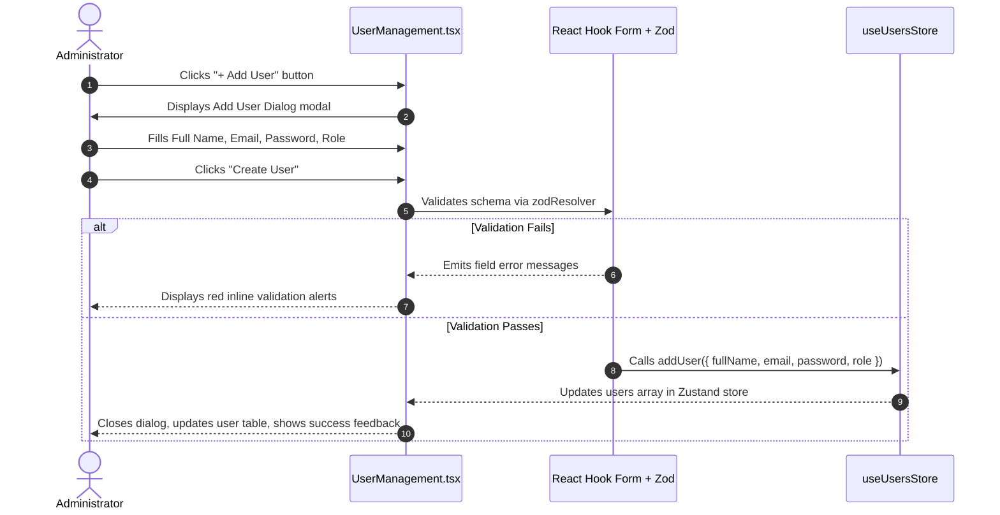

# 02. ADMIN MODULE DOCUMENTATION
## CoEdit.ai – System Administration Portal

---

## 1. ADMIN MODULE OVERVIEW

### 1.1 Purpose & Role
The **Admin Module** (System Administration Portal) serves as the governance and oversight hub for the CoEdit.ai enterprise authoring platform. It enables designated system administrators (`Role.Admin`) to monitor platform usage, analyze user role distributions, register and manage author credentials, execute security password updates, and export user audits to standardized spreadsheets.

### 1.2 Architectural Foundation
- **Parent Layout:** `DashboardLayout.tsx` (located at `editor/src/app/layouts/DashboardLayout.tsx`).
- **Access Guard:** Protected by both `AuthGuard` (verifies active user session) and `RoleGuard([Role.Admin])` (restricts entry to users with the administrator role).
- **State Store:** Consumes and manipulates user entities reactively via the global Zustand store `useUsersStore` (`editor/src/shared/stores/usersStore.ts`).
- **Styling Architecture:** Styled with Tailwind CSS, utilizing a light canvas background (`bg-[#EEF7FF]`), brand sidebar blue (`bg-[#D3E3FC]`), deep text navy (`text-[#172033]`), and seamless dark mode toggling (`dark:bg-[#0B1426]` / `dark:bg-[#0D213D]`).

---

## 2. ADMIN SHELL LAYOUT (`DashboardLayout.tsx`)

The Admin shell wraps all admin sub-routes, delivering persistent navigation, global controls, and session management.

```text
DashboardLayout
├── Fixed Collapsible Sidebar Rail (Left)
│   ├── Logo & Brand Title (DocuPilot)
│   ├── Navigation Menu (Dashboard, Users)
│   ├── Workspace Profile Pill Trigger
│   └── Sign Out Action Button
└── Main Container (Right)
    ├── Sticky Top Header Bar
    │   ├── Hamburger Sidebar Toggle
    │   ├── Portal Title ("SYSTEM ADMIN PORTAL")
    │   └── Light / Dark Mode Toggle Button
    └── Scrollable Main Content Canvas (<Outlet />)
```

### 2.1 Sidebar Rail Features
- **Responsive Width:**
  - Expanded width: `188px`.
  - Collapsed width: `64px`.
  - Mobile viewports ($< 1024\text{px}$): Transforms into an off-canvas drawer (`-translate-x-full` to `translate-x-0`).
  - State persistence: Remembers user preference across sessions via `localStorage.getItem("sidebarExpanded")`.
- **Branding Header:**
  - Displays the high-resolution logo `docupilot-logo.png`.
  - In expanded mode, displays bold title `"Docu Pilot"` and subtitle `"Doc. Prep. Reimagined!"`.
- **Navigation Links:**
  - `Dashboard` (`/dashboard`): Icon `LayoutGrid`.
  - `Users` (`/dashboard/users`): Icon `Users`.
  - Active Route Pill: Highlighted with an active white card background (`bg-white shadow-xs`), navy text (`text-[#324480]`), or cyan text in dark mode (`dark:text-[#38BDF8]`).
  - Inactive Links: Rendered in slate gray (`text-[#64748B]`) with soft hover effects (`hover:bg-white/60`).
- **Bottom Profile Pill:**
  - Displays an avatar circle with an emerald online status dot (`bg-[#10B981]`).
  - Displays workspace label `"Workspace"`.
  - Clicking this pill triggers the **Admin Profile & Security Dialog**.
- **Sign Out Button:**
  - Icon `LogOut`.
  - Invokes `logout()` from `useAuth()`, destroying client credentials and redirecting to `/login`.

### 2.2 Sticky Top Header Bar
- **Sidebar Toggle Button:** Icon `Menu`. Toggles rail collapse state on desktop and opens the drawer on mobile.
- **Portal Title:** Displays `"SYSTEM ADMIN PORTAL"` in bold uppercase tracked typography.
- **Theme Switcher:** Toggles between light theme and dark theme (`Sun` / `Moon` icon), updating the root `dark` class on the HTML root element.

### 2.3 Admin Profile & Security Dialog (`AdminProfileSecurity`)
Rendered when clicking the bottom profile pill. Features an accessible modal dialog with two tabs:
1. **Profile Overview Tab:**
   - Displays Administrator Email (`email`, defaults to active user email or `admin@gmail.com`).
   - Displays Account Role (`role`, displayed as uppercase badge `ADMIN`).
   - Primary action button: `"Change Admin Password"` with `KeyRound` icon (switches directly to Password tab).
2. **Change Admin Password Tab:**
   - Email field (read-only input).
   - New Password field with visibility toggle button (`Eye` / `EyeOff`).
   - Confirm New Password field with visibility toggle button (`Eye` / `EyeOff`).
   - Real-time client validation checks before submission.
   - Success alert banner: `"Admin password updated successfully!"` in green banner with `CheckCircle2`.
   - Error banner: Displays specific validation failure message.
   - Cancel and `"Save New Password"` action buttons.

---

## 3. ROUTE-WISE DOCUMENTATION

### 3.1 Route 1: Admin Overview Dashboard

#### 3.1.1 Route Information
- **Page Name:** Admin Overview / Dashboard Home
- **Route URL:** `/dashboard`
- **Parent Layout:** `DashboardLayout`
- **Navigation Path:** Sidebar $\rightarrow$ "Dashboard"
- **Main Component:** `DashboardHome` (`editor/src/features/dashboard/pages/Dashboard.tsx`)
- **Child Presentation Component:** `DashboardOverview` (`editor/src/features/dashboard/components/DashboardOverview.tsx`)
- **State Store Binding:** `useUsersStore()`

#### 3.1.2 UI Components & Layout
The page is organized into three visual tiers:
1. **Page Header:**
   - Main Title: `"System Administration Overview"` (`text-2xl md:text-3xl font-extrabold text-[#172033] dark:text-white`).
2. **Key Metric Summary Cards (3-Column Grid):**
   - **Card 1: Total Registered Users:**
     - Label: `"Total Registered Users"`
     - Icon: `Users` in sky-blue circular badge (`bg-[#EBF7FD] text-[#0284C7]`).
     - Value: Dynamic integer aggregating total users in store (`totalUsers = users.length`).
     - Subtitle: `"All registered users in the system"`.
   - **Card 2: Admin Accounts:**
     - Label: `"Admin Accounts"`
     - Icon: `ShieldCheck` in amber circular badge (`bg-[#FFFBEB] text-[#D97706]`).
     - Value: Dynamic count of users with `role === "Admin"`.
     - Subtitle: `"Full system management"`.
   - **Card 3: Author Accounts:**
     - Label: `"Author Accounts"`
     - Icon: `FileText` in rose circular badge (`bg-[#FFF1F2] text-[#E11D48]`).
     - Value: Dynamic count of users with `role === "Author"`.
     - Subtitle: `"Document access and contribution"`.
3. **User Role Distribution Card:**
   - Card Title: `"User Role Distribution"`, Subtitle: `"User access by role"`.
   - **Admins Progress Row:**
     - Icon: `Users`.
     - Label: `"Admins"`.
     - Progress Bar: Width calculated dynamically via `style={{ width: `${adminPct}%` }}` with cyan background (`bg-[#8ADFF3]`).
     - Stats: Absolute count, divider (`|`), and percentage (`adminPct%`).
   - **Authors Progress Row:**
     - Icon: `Pencil`.
     - Label: `"Authors"`.
     - Progress Bar: Width calculated dynamically via `style={{ width: `${authorPct}%` }}` with light-blue background (`bg-[#BFDBFE]`).
     - Stats: Absolute count, divider (`|`), and percentage (`authorPct%`).

---

### 3.2 Route 2: User Management

#### 3.2.1 Route Information
- **Page Name:** User Management
- **Route URL:** `/dashboard/users`
- **Parent Layout:** `DashboardLayout`
- **Navigation Path:** Sidebar $\rightarrow$ "Users"
- **Main Component:** `UsersPage` (`editor/src/features/dashboard/pages/Users.tsx`)
- **Child Presentation Component:** `UserManagement` (`editor/src/features/dashboard/components/UserManagement.tsx`)
- **State Store Binding:** `useUsersStore()` (`fetchUsers`, `users`, `isLoading`, `addUser`, `changeUserPassword`, `searchQuery`, `roleFilter`)

#### 3.2.2 UI Components & Controls
1. **Top Action Toolbar:**
   - **Search Input:** Search input with `Search` icon. Filters users in real time across Full Name and Email attributes.
   - **Role Filter Dropdown:** Select control with options: `"All Roles"`, `"Admin"`, `"Author"`.
   - **Export to Excel Button:** Icon `FileSpreadsheet`. Exports active filtered user list to `.xlsx` spreadsheet using SheetJS.
   - **Add User Button:** Primary button (`+ Add User`) with `Plus` icon. Opens the Add User modal dialog.
2. **User Data Table:**
   - Responsive table with columns:
     - `User`: Displays round avatar with capitalized initial, Full Name in bold, and Email address.
     - `Role`: Rendered as a distinct pill badge (Admin in amber/sky, Author in indigo).
     - `Created`: Formatted date with `Calendar` icon.
     - `Actions`: Action buttons per row:
       - *View User:* Eye icon (`Eye`). Opens read-only summary dialog.
       - *Change Password:* Key icon (`KeyRound`). Opens user password reset modal.
       - *Invite Link:* Share icon (`Share2`). Opens shareable invitation dialog.
3. **Empty & Loading States:**
   - *Loading State:* Centered animated spinner (`Loader2`) during asynchronous user fetching.
   - *Empty State:* Displayed when `users.length === 0` or search filters yield zero results; shows search illustration and helper prompt.
4. **Modals & Dialogs in User Management:**
   - **Add User Modal (`isAddOpen`):** Form powered by `react-hook-form` and `zodResolver(addUserFormSchema)`.
   - **View User Modal (`isViewOpen`):** Displays read-only profile details, avatar, registered role, and join date.
   - **Change Password Modal (`isPasswordOpen`):** Allows administrator to set a new password for a selected user account.
   - **Invite Modal (`isInviteOpen`):** Generates portal invitation link with one-click copy button (`Copy` / `Check`).

---

## 4. FORM VALIDATION SPECIFICATIONS

### 4.1 Add User Form Schema (`addUserFormSchema`)
Verified from `editor/src/features/dashboard/components/UserManagement.tsx`:

```typescript
const addUserFormSchema = z.object({
  fullName: z
    .string()
    .min(3, { message: "Full Name must contain at least 3 characters" }),
  email: z
    .string()
    .min(1, { message: "Email address is required" })
    .email({ message: "Provide a valid email address" }),
  password: z
    .string()
    .min(6, { message: "Password must contain at least 6 characters" }),
  role: z.enum(["Admin", "Author"]),
});
```

| Field Name | Type | UI Control | Validation Constraints | Exact Error Message |
|---|---|---|---|---|
| `fullName` | String | Input | Required; Minimum 3 characters | `"Full Name must contain at least 3 characters"` |
| `email` | String | Input | Required; Valid email RFC syntax | `"Email address is required"` / `"Provide a valid email address"` |
| `password` | String | Password Input | Required; Minimum 6 characters | `"Password must contain at least 6 characters"` |
| `role` | Enum | Select Dropdown | Must be `"Admin"` or `"Author"` | Form schema validation |

### 4.2 Admin Self-Password Modification Validation (`handleSavePassword`)
Verified from `editor/src/app/layouts/DashboardLayout.tsx`:

| Validation Rule | Constraint Logic | Exact Error Message |
|---|---|---|
| **Identity Check** | Must have valid `user.id` | `"Unable to identify the administrator."` |
| **Minimum Length** | `newPassword.length < 8` | `"Password must contain at least 8 characters."` |
| **Maximum Bytes** | `new TextEncoder().encode(newPassword).length > 72` | `"Password must not exceed 72 bytes."` |
| **Uppercase Character** | `!/[A-Z]/.test(newPassword)` | `"Password must contain at least one uppercase letter."` |
| **Lowercase Character** | `!/[a-z]/.test(newPassword)` | `"Password must contain at least one lowercase letter."` |
| **Numeric Digit** | `!/[0-9]/.test(newPassword)` | `"Password must contain at least one number."` |
| **Special Character** | `!/[^A-Za-z0-9]/.test(newPassword)` | `"Password must contain at least one special character."` |
| **Password Confirmation** | `newPassword !== confirmPassword` | `"Passwords do not match."` |

---

## 5. USER WORKFLOWS & INTERACTION LIFECYCLES

### 5.1 Admin User Creation Workflow


### 5.2 Excel Export Workflow
1. Administrator navigates to `/dashboard/users`.
2. Administrator applies optional search filter (`searchQuery`) and role filter (`roleFilter`).
3. Administrator clicks `"Export to Excel"`.
4. Client-side handler formats active user list into row objects: `{ "Full Name", "Email", "Role", "Created Date" }`.
5. SheetJS `XLSX.utils.json_to_sheet` creates an in-memory worksheet.
6. `XLSX.writeFile` triggers a browser file download: `Users_Export_<timestamp>.xlsx`.
