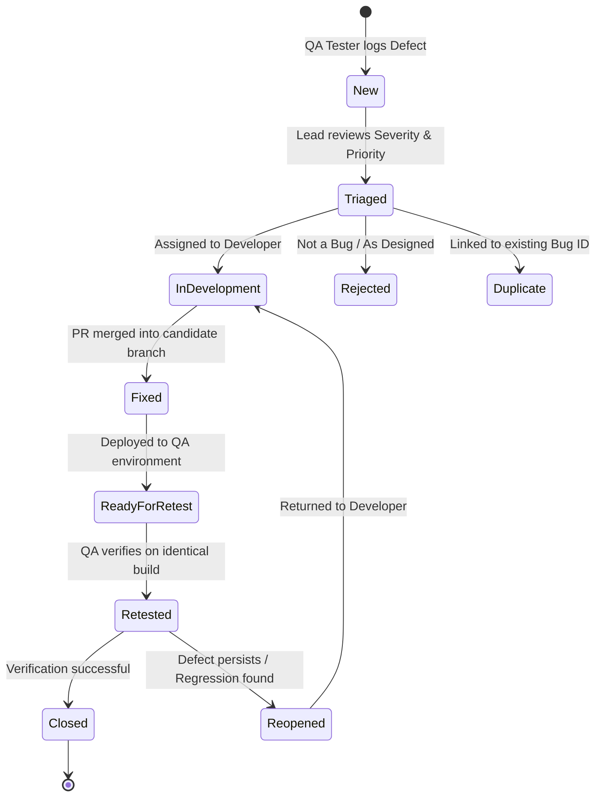

# CoEdit.ai – Test Execution & Defect Tracking Guide

---

## 1. Quality Assurance Overview

| Property | Value |
| :--- | :--- |
| **Document Title** | Test Execution, Defect Reporting & Quality Sign-Off Guide |
| **System Name** | CoEdit.ai Document Editor & Admin Management Platform |
| **Version Scope** | Release Candidate (v1.0.0-rc) |
| **Scope Boundary** | Frontend Client-Side Application Only |
| **Target Audience** | QA Engineers, Frontend Developers, Release Managers, Product Owners |
| **Associated Test Workbook** | `06_FRONTEND_TEST_CASES.xlsx` (14 Sheets, 81 Core Scenarios) |

---

## 2. Test Execution Summary & Status Metrics

### 2.1 Execution Status Definitions

| Status | Code | Definition | Entry Criteria | Exit Criteria |
| :--- | :--- | :--- | :--- | :--- |
| **Not Executed** | `NE` | The test case has been formally documented but has not yet been executed against the build. | Test case authored, reviewed, and approved. | QA tester begins active test execution. |
| **Pass** | `PASS` | All test steps were completed and actual results match expected criteria without error. | Execution completed according to exact steps. | Results verified; evidence logged. |
| **Fail** | `FAIL` | Actual results diverge from expected criteria, or an unhandled client exception occurred. | Discrepancy observed during step execution. | Defect logged with Bug ID linked to test case. |
| **Blocked** | `BLOCKED` | The test step or prerequisite cannot be reached due to an upstream critical defect or environment dependency. | Blocker defect prevents reaching target feature. | Blocker resolved and deployed for retesting. |

### 2.2 Test Suite Execution Baseline

| Module / Domain | Total Cases | Not Executed | Pass | Fail | Blocked | Pass Rate (%) |
| :--- | :--- | :--- | :--- | :--- | :--- | :--- |
| **Admin UI & Layout** | 10 | 10 | 0 | 0 | 0 | 0.0% (Baseline) |
| **Admin Functional & Forms** | 13 | 13 | 0 | 0 | 0 | 0.0% (Baseline) |
| **Admin Responsive Viewports** | 6 | 6 | 0 | 0 | 0 | 0.0% (Baseline) |
| **Editor UI & Workspace Canvas**| 8 | 8 | 0 | 0 | 0 | 0.0% (Baseline) |
| **Editor Functional Operations** | 10 | 10 | 0 | 0 | 0 | 0.0% (Baseline) |
| **Document Submodule (Breaks & Search)** | 8 | 8 | 0 | 0 | 0 | 0.0% (Baseline) |
| **Writing Submodule (Formatting & Lists)** | 8 | 8 | 0 | 0 | 0 | 0.0% (Baseline) |
| **Styles Submodule (Gallery & Reset)** | 6 | 6 | 0 | 0 | 0 | 0.0% (Baseline) |
| **Symbols Submodule (Math & Greek)** | 6 | 6 | 0 | 0 | 0 | 0.0% (Baseline) |
| **Ribbon Toolbar & Dropdown Menus** | 13 | 13 | 0 | 0 | 0 | 0.0% (Baseline) |
| **Navigation & Reference Submodule** | 8 | 8 | 0 | 0 | 0 | 0.0% (Baseline) |
| **Editor Responsive Viewports** | 6 | 6 | 0 | 0 | 0 | 0.0% (Baseline) |
| **Accessibility Compliance (WCAG AA)**| 6 | 6 | 0 | 0 | 0 | 0.0% (Baseline) |
| **Cross-Browser Verification** | 4 | 4 | 0 | 0 | 0 | 0.0% (Baseline) |
| **Total Comprehensive Test Suite** | **81** | **81** | **0** | **0** | **0** | **0.0% (Pre-Execution)** |

---

## 3. Defect Reporting Template & Schema

Every defect discovered during frontend test execution must be logged using the standardized schema below.

### 3.1 Standard Defect Attributes

| Attribute | Type | Description | Mandatory | Example |
| :--- | :--- | :--- | :--- | :--- |
| **Bug ID** | String | Unique defect identifier (`BUG-EDT-xxx` or `BUG-ADM-xxx`) | Yes | `BUG-EDT-014` |
| **Test Case ID** | String | Reference to initiating test case ID | Yes | `EDT-RB-004` |
| **Module** | String | High-level module (Admin, Editor, Universal) | Yes | `Editor` |
| **Submodule** | String | Specific component or submodule | Yes | `Ribbon` |
| **Page Name** | String | Display name of the page | Yes | `Document Editor` |
| **Route** | String | Exact client URL route where bug manifested | Yes | `/editor` |
| **Bug Title** | String | Concise, imperative description of the defect | Yes | `Font size dropdown does not sync with selected heading size` |
| **Environment** | String | Browser version, Operating System, Screen Resolution | Yes | `Chrome v130 / Win 11 / 1920x1080` |
| **Severity** | Enum | Critical, High, Medium, Low | Yes | `High` |
| **Priority** | Enum | P1 (Urgent), P2 (High), P3 (Medium), P4 (Low) | Yes | `P2` |
| **Preconditions** | String | System or document state prior to reproduction | No | `Document loaded with H1 heading text` |
| **Steps to Reproduce** | Ordered List | Exact chronological steps required to reproduce defect | Yes | `1. Select H1 text in canvas` `2. Observe Font Size dropdown` |
| **Expected Result** | String | Specified expected behavior | Yes | `Dropdown displays '24' matching H1 style` |
| **Actual Result** | String | Observed incorrect behavior or error stack | Yes | `Dropdown remains blank or shows default '11'` |
| **Console Errors** | String | Relevant browser DevTools console messages | No | `None (DOM synchronization failure)` |
| **Attachment** | File Path | Screenshot, GIF, or DOM recording of the defect | Yes | `screenshots/bug_edt_014.png` |
| **Status** | Enum | New, Assigned, In Progress, Fixed, Retested, Closed | Yes | `New` |

---

## 4. Severity & Priority Classification Matrix

### 4.1 Defect Severity Definitions (Technical Impact)

| Severity Level | Definition | Technical Criteria | Frontend Examples |
| :--- | :--- | :--- | :--- |
| **Critical** | Unrecoverable crash, data destruction, or complete feature blockage with no workaround. | Uncaught React error boundary trigger, white screen of death (WSOD), client-side memory leak freezing the tab, inability to open `/dashboard` or `/editor`. | Clicking "Add User" throws uncaught runtime exception; document canvas crashes and fails to render text. |
| **High** | Major functional defect severely degrading user workflow; cumbersome workaround or no immediate workaround. | Key interactive operation fails, form validation allows corrupted data dispatch, synchronization between document state and toolbar fails. | Font family/size dropdowns fail to reflect selected text styles; "Insert Table" fails to append DOM nodes; search filter crashes user grid. |
| **Medium** | Functional defect with a clear, reasonable workaround; visual layout defect violating design specifications. | Responsive alignment defect on mobile/tablet viewports, minor styling overflow, incorrect button icon, missing tooltip. | Navigation panel Web URL tab inputs misaligned by 4px compared to Email tab; Recent Activity table lacks horizontal scroll container on mobile. |
| **Low** | Cosmetic or minor discrepancy with negligible impact on functionality or user productivity. | Minor typo in help label, minor color shade deviation (<5% delta-E), animation easing inconsistency. | Tip text at bottom of Writing panel has missing period; hover shadow delay is 150ms instead of 200ms. |

### 4.2 Defect Priority Definitions (Business / Scheduling Urgency)

| Priority Level | SLA / Target Resolution | Resolution Scope | Typical Assignment |
| :--- | :--- | :--- | :--- |
| **P1 – Immediate** | Fix within 4 to 8 hours | Release Blocker: Must be resolved before any deployment to production or staging. | Assigned immediately to senior frontend engineer. |
| **P2 – Urgent** | Fix within 24 to 48 hours | High-Impact Issue: Major user workflow impairment; must be included in next candidate build. | Scheduled for current sprint release candidate. |
| **P3 – Normal** | Fix within regular sprint cycle | Standard Bug: Normal priority defect with known workaround. | Backlog refinement and sprint planning. |
| **P4 – Low** | Backlog / Opportunistic fix | Minor Cosmetic: Addressed during design polish or cleanup passes. | Assigned as nice-to-have or tech debt item. |

---

## 5. Defect Lifecycle Workflow

### 5.1 Retesting Protocol & Guidelines
1. **Verification Environment:** Always retest defects on a clean, isolated browser profile or incognito session to prevent cached JavaScript bundles or local storage artifacts.
2. **Exact Step Reproduction:** Follow the exact chronological steps specified in the original bug report.
3. **Surrounding Regression Checks:** In addition to validating the bug fix itself, test 2 to 3 related features in the same submodule to detect regressions (e.g. when verifying font-family selection synchronization, also verify font-size synchronization and bold/italic toggle states).
4. **Resolution Documentation:** When closing a bug, document the exact build/commit hash tested, browser version, and append a verification screenshot.

---

## 6. Known Frontend Observations & Architectural Assumptions

Based on thorough static code analysis of the CoEdit.ai frontend repository:

1. **Selection Synchronization Architecture:**
   - Text styling synchronization between the document canvas and the Ribbon toolbar relies on DOM `selectionchange` event listeners. When text is selected across mixed formatting boundaries (e.g. half bold, half normal), dropdowns should default to the format of the first character or show a blank state.
2. **Client-Side State Persistence:**
   - User data on `/dashboard/users` is managed via Zustand (`useUsersStore`). Mutations (Add, Edit, Delete) are stored in client memory; page reloads reset the mock store to its initial seed data unless local storage persistence middleware is active.
3. **Responsive Breakpoints & Drawers:**
   - Mobile and tablet drawer overlays (Left Overlay, AI Assistant, Mobile Admin Sidebar) use Tailwind's `z-50` backdrop blur containers. On small mobile viewports (<= 375px), drawers intentionally occupy full screen width (`w-full`) to optimize touch targets.
4. **Canvas Virtualization:**
   - Multi-page document layout flows dynamically based on page height metrics. Zoom levels scale the canvas wrapper via CSS `transform: scale()` while maintaining top-center transform origin.

---

## 7. Pre-Release QA Sign-Off Checklist

Before granting production release authorization, the QA Lead and Frontend Engineering Lead must verify each requirement below:

- [ ] **1. Core Route Integrity:** All routes (`/dashboard`, `/dashboard/users`, `/editor`) load directly on cold refresh without 404 or redirect loops.
- [ ] **2. Zero Critical / High Severity Bugs:** No open P1 or P2 defects remain unresolved in the release candidate branch.
- [ ] **3. Ribbon Toolbar Verification:** All 4 top-level tabs (Home, Insert, Layout, Review) and contextual tabs switch cleanly with zero UI jitter.
- [ ] **4. Text Selection Synchronization:** Selection of text in document canvas accurately updates Font Family, Font Size, and Line Spacing ribbon dropdowns.
- [ ] **5. Navigation Internal Reference Form Consistency:** Web URL and Email tabs in Navigation overlay adhere to identical padding, border radii, typography, and button dimensions.
- [ ] **6. User Management Operations:** Add User, Edit User, Delete User, Search, and Filtering operate reliably without store corruption.
- [ ] **7. Responsive Layout Verification:** All 6 target viewports (375px, 768px, 1024px, 1280px, 1440px, 1920px) render without horizontal overflow or text clipping.
- [ ] **8. Accessibility Compliance:** Keyboard `Tab` navigation functions across all forms, dialogs trap focus, and `Escape` dismisses overlays.
- [ ] **9. Cross-Browser Stability:** Verified on Google Chrome, Microsoft Edge, Mozilla Firefox, and Apple Safari.
- [ ] **10. Build & TypeScript Hygiene:** `npm run build` completes with 0 errors and 0 unhandled TypeScript type failures.

---

### Sign-Off Approvals

| Role | Name | Signature | Date | Decision |
| :--- | :--- | :--- | :--- | :--- |
| **QA Lead** | Quality Assurance Team | *Pending Execution* | — | *Awaiting Test Suite Run* |
| **Frontend Lead** | Engineering Team | *Pending Execution* | — | *Awaiting Test Suite Run* |
| **Product Owner** | CoEdit.ai Product Management | *Pending Execution* | — | *Awaiting Test Suite Run* |

---
*End of Test Execution & Defect Tracking Guide – CoEdit.ai Frontend Platform.*
